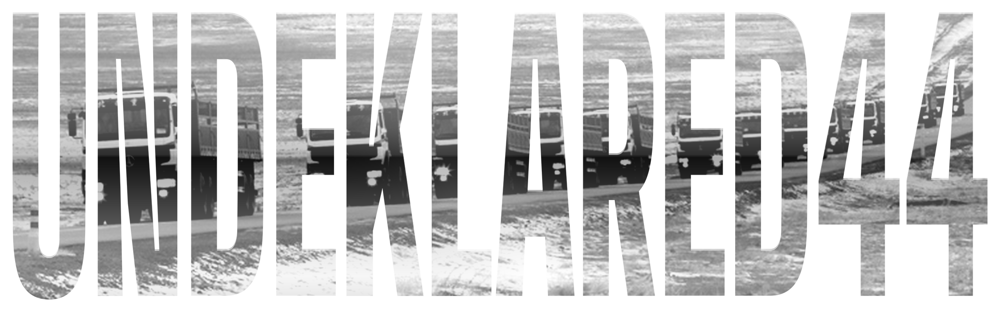
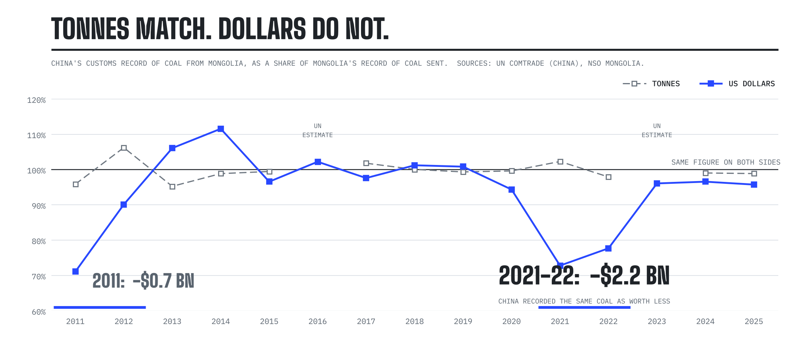
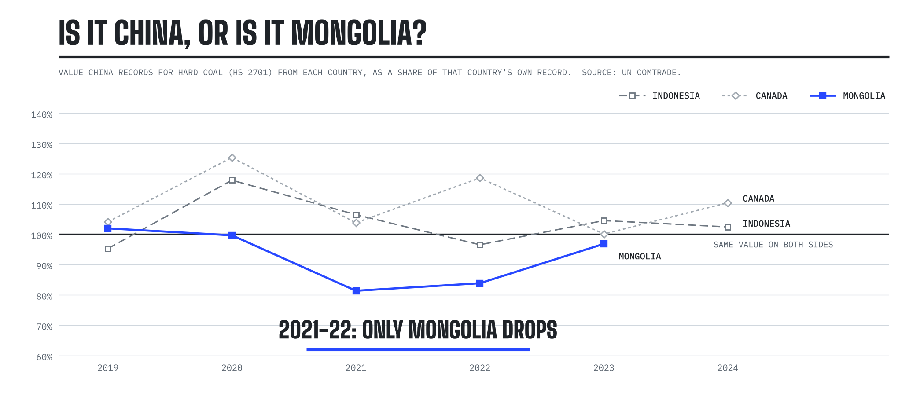
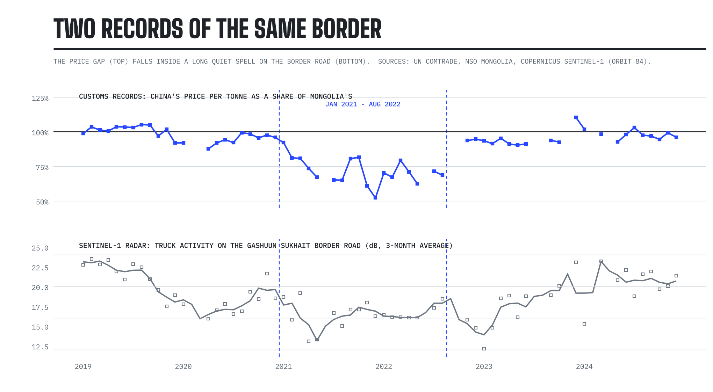
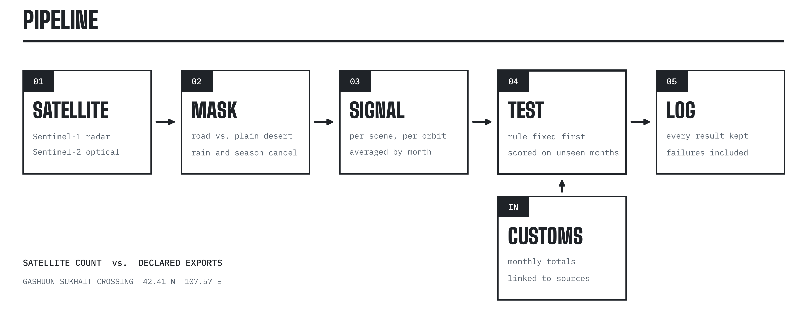

<p align="center"></p>

<p align="center">
  <a href="https://github.com/dulguuntsatsralt-cell/undeklared44/actions/workflows/tests.yml"></a>
  
  
  
</p>

# undeklared44

**Checking Mongolia's coal exports to China against two independent records: China's own customs data and free satellite imagery.**

## Why

In late 2022, thousands of people protested in Ulaanbaatar over what became known as the coal theft case: allegations that coal from the state mining company was sold off the books to buyers at the Chinese border. Protesters and the opposition put the loss at around 44 trillion tögrög (about US$13 billion). That figure was never officially confirmed; investigations and court cases followed.

Mongolia's own statistics are the usual record of how much coal leaves the country and what it was worth. This project asks what other records say.

The project makes no claim about any person or company. It compares records, not culpability.

## Findings

### 1. The tonnes match

China's customs record of coal arriving from Mongolia is within 95% to 106% of Mongolia's record of coal leaving in every year with reported figures, and within about 2% every year since 2017. Over 2017 to 2025 China records slightly *less* coal than Mongolia, not more. **There is no sign of coal crossing the border undeclared** at the level of national customs records.

### 2. The dollars do not, for 20 months

<picture>
  <source media="(prefers-color-scheme: dark)" srcset="assets/mirror-gap-dark.png">
  
</picture>

From **January 2021 to August 2022**, China recorded the same coal at a price a fifth to a third lower than Mongolia did: **about US$2 billion** less in total. The gap opens in early 2021, is widest from February to August 2022 (57% to 77% in single months), closes in September 2022 and does not come back. It runs the opposite way from normal: China's figure includes freight and insurance and should be slightly *higher*.

It is not a timing difference: China's price moves in the same month as Mongolia's and never catches up later.

### 3. Only Mongolia's coal

<picture>
  <source media="(prefers-color-scheme: dark)" srcset="assets/mirror-control-dark.png">
  
</picture>

In the same years, China recorded Indonesian and Canadian coal at the same value as those countries did, or higher. Only Mongolian coal was recorded lower. So this is not a general feature of how China valued coal imports.

The gap closed about a month before the head of the state coal company was fired (October 2022). He was later arrested over alleged off-the-books sales to Chinese buyers at the border. The timing is suggestive, not proof: coal prices were also falling fast then.

**Open question:** either Chinese buyers declared Mongolian coal below its real price, or Mongolian customs valued it at a benchmark well above what it was actually sold for. Both mean the coal changed hands far below the price Mongolia recorded, during the period of the alleged theft. Which record is the odd one depends on Mongolia's customs valuation rules for 2021-22, which are not yet confirmed. Full write-up: [`results/2026-10-14_mirror_gap.md`](results/2026-10-14_mirror_gap.md).

## What the satellites show

<picture>
  <source media="(prefers-color-scheme: dark)" srcset="assets/border-context-dark.png">
  
</picture>

Sentinel-1 radar of the border road gives a record that does not depend on any government. It shows the crossing at its quietest in six years through 2021-22, the period of COVID border closures, which is the period of the price gap. That is context, not proof of cause.

The satellites were also tested as direct measures, five times, each with the rule written down before the data was looked at. All five failed, for reasons that are now understood:

| Test | Result | What it taught |
|---|---|---|
| Radar truck queue at the border vs exports (2026) | Failed | A queue measures congestion, not volume |
| Coal cover in the border yard vs exports (2026) | Failed | Coal in a yard is a stock, not a flow; the sign flipped between years |
| Same yard measure, opposite sign, on 2022-2024 | Failed | No relation month to month in either direction |
| Radar congestion vs the price gap (2019-2024) | Failed, opposite sign | Radar cannot tell a closed border from a quiet one |
| Moving-truck counter on the coal road vs exports (2019-2022) | Failed | Three snapshots a month of 9 km of road are too sparse |

Each test, its rule and its numbers are in [`results/README.md`](results/README.md). Failed tests stay in the log.

## Method

<picture>
  <source media="(prefers-color-scheme: dark)" srcset="assets/pipeline-dark.png">
  
</picture>

- **Customs records:** Mongolia's National Statistics Office (coal exports by month since 2011, volume and value) and UN Comtrade (China's imports from Mongolia, and both sides for Indonesia, Canada and others), HS 2701, 2702, 2704.
- **Imagery:** Sentinel-1 radar and Sentinel-2 optical, free through the Microsoft Planetary Computer, on one shared 10 m grid. Road and yard areas are hand-drawn or taken from OpenStreetMap.
- **Testing:** every satellite measure is fixed in a dated pre-registration file before the data it is tested on is downloaded, then scored once. Changes after a rule is written get their own dated note.

## Setup

```bash
python -m venv .venv
source .venv/bin/activate          # Windows PowerShell: .\.venv\Scripts\Activate.ps1
pip install -e ".[dev]"
pytest
```

## Reproduce

```bash
python scripts/fetch_trade.py                       # both countries' customs records (NSO, UN Comtrade)
python scripts/mirror_gap.py                        # yearly comparison -> results/mirror_gap_annual.csv
python scripts/build_s1_signal.py gashuunsukhait 2019-01 2026-09   # radar of the border road
python scripts/build_s2_signal.py gashuunsukhait 2022-01 2026-09   # coal cover in the border yard
python scripts/build_trucks.py coal_road 2019-01 2024-12           # moving-truck counter (then --tune, --signal)
python scripts/score_*.py ...                       # each pre-registered test
```

Satellite scenes are saved to `data/raw/` and `data/raw_s2/` (not in git). Re-running only downloads what is missing.

## Layout

```
src/coalcast/
  aois.py       areas watched (border crossing, coal road, ...)
  fetch.py      Sentinel-1 and Sentinel-2 access
  features.py   road, yard and truck measures; masks
  evaluate.py   pre-registered tests, detrending, walk-forward testing, bootstrap intervals
scripts/        downloads, signals, scoring, customs comparison
tests/          unit tests, including checks that testing never uses future data
data/           customs records, masks, OpenStreetMap road line
results/        pre-registrations, results log, write-ups
```

## Limits

- A gap between two sets of records is where to look, not proof of wrongdoing.
- Yearly and monthly customs totals cannot see coal taken before the border and then exported legally under another company's name.
- China's tonnage for 2016 and 2023 is a UN estimate and is left out of tonnage comparisons.

## Sources

- [UN Comtrade](https://comtradeplus.un.org/) and [NSO Mongolia, foreign trade tables](https://data.1212.mn/pxweb/en/NSO/)
- [Copernicus Sentinel data via Microsoft Planetary Computer](https://planetarycomputer.microsoft.com/)
- [2022 Mongolian protests](https://en.wikipedia.org/wiki/2022_Mongolian_protests)
- [Al Jazeera: Mongolia vows to clean up coal trade after fury over China deals (2023)](https://www.aljazeera.com/economy/2023/1/25/after-anti-corruption-protests-mongolia-rethinks-coal-sales)
- [East Asia Forum: Coal smuggling trains the Mongolian public's eye on systemic corruption (2023)](https://www.eastasiaforum.org/2023/04/17/coal-smuggling-trains-the-mongolian-publics-eye-on-systemic-corruption/)
- [CMI: The coal theft case: corruption and reform of Mongolia's strategic minerals governance](https://www.cmi.no/publications/file/9169-the-coal-theft-case-corruption-and-reform-of-mongolias-strategic-minerals-governance.pdf)
- [Fisser et al. 2022, Detecting Moving Trucks on Roads Using Sentinel-2 Data](https://www.mdpi.com/2072-4292/14/7/1595/html)
