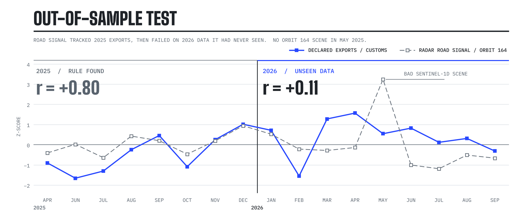

<p align="center"></p>

<p align="center">
  <a href="https://github.com/dulguuntsatsralt-cell/undaklared44/actions/workflows/tests.yml"></a>
  
  
  
</p>

# undaklared44

**An independent satellite count of the coal that crosses Mongolia's border with China, built to compare against the declared export figures.**

## Why

In late 2022, thousands of people protested in Ulaanbaatar over what became known as the coal theft case. Reporting described coal crossing into China without customs registration, and protesters and the opposition estimated lost state revenue at around 44 trillion tugrik (about US$13 billion). That figure was never officially confirmed, and investigations and court cases followed. A former member of parliament had already warned in 2018 about millions of tonnes of coal missing from customs declarations.

Official statistics are the only public record of how much coal leaves the country. This project asks whether free satellite imagery can provide a second, independent record:

1. **Track declared exports.** Can satellite signals at the border follow the official monthly figures? If not, they cannot say anything about undeclared flows either.
2. **Compare.** If they can, a persistent gap between what satellites see and what is declared becomes a question worth asking.

The project makes no claim about any person or company. It measures coal, not culpability.

## Status

**Step 1 is not solved yet.** The first signal, radar brightness on the truck road at the Gashuunsukhait crossing, matched 2025 exports (correlation +0.80) but failed when tested on 2026 data it had not seen (+0.11). The likely reason: a truck queue measures congestion, not volume. Full write-up in [`results/README.md`](results/README.md).

<picture>
  <source media="(prefers-color-scheme: dark)" srcset="assets/results-dark.png">
  
</picture>

Next: coal stockpile area at the border yards (Sentinel-2) and rail wagon counts, tested the same way.

## Method

<picture>
  <source media="(prefers-color-scheme: dark)" srcset="assets/pipeline-dark.png">
  
</picture>

- **Imagery:** Sentinel-1 radar (all weather, day and night) and Sentinel-2 optical, free through the Microsoft Planetary Computer.
- **Target:** monthly coal exports from Mongolia's Customs General Administration, collected in [`data/exports_monthly.csv`](data/exports_monthly.csv) with a source link for every number.
- **Signals:** each image is compared with a nearby patch of plain desert, so rain and season cancel out. Scenes are grouped by satellite orbit because viewing angle changes brightness.
- **Testing:** every measure is fixed on one period, then tested once on months it has not seen. Failed tests stay in the results log.

## Setup

```bash
python -m venv .venv
source .venv/bin/activate          # Windows PowerShell: .\.venv\Scripts\Activate.ps1
pip install -e ".[dev]"
pytest
```

## Run

```bash
python scripts/preview_aoi.py gashuunsukhait                       # check the area box
python scripts/make_masks.py gashuunsukhait                        # road and control masks from data/masks_<aoi>.geojson
python scripts/build_s1_signal.py gashuunsukhait 2025-01 2026-09   # download radar scenes and build the signal
```

Scenes are saved to `data/raw/` (not in git). Re-running only downloads what is missing; add `--signal-only` to rebuild the signal without downloading.

## Layout

```
src/coalcast/
  aois.py       areas watched (Gashuunsukhait crossing, Tavan Tolgoi mine, ...)
  fetch.py      Sentinel-1 and Sentinel-2 access
  features.py   road, transient and coal-pixel measures; masks; monthly features
  evaluate.py   baselines, walk-forward testing, bootstrap intervals, Diebold-Mariano test
scripts/        preview_aoi.py, make_masks.py, build_s1_signal.py
tests/          unit tests, including a check that testing never uses future data
data/           export figures and hand-drawn masks
results/        one entry per experiment, including failures
```

## Sources

- [2022 Mongolian protests](https://en.wikipedia.org/wiki/2022_Mongolian_protests)
- [East Asia Forum: Coal smuggling trains the Mongolian public's eye on systemic corruption (2023)](https://www.eastasiaforum.org/2023/04/17/coal-smuggling-trains-the-mongolian-publics-eye-on-systemic-corruption/)
- [CMI: The coal theft case: corruption and reform of Mongolia's strategic minerals governance](https://www.cmi.no/publications/file/9169-the-coal-theft-case-corruption-and-reform-of-mongolias-strategic-minerals-governance.pdf)
